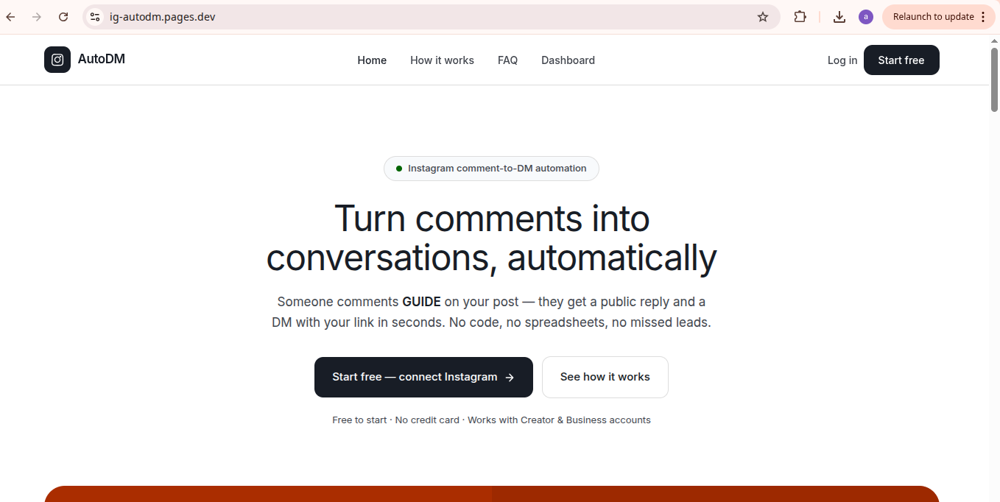

# IG AutoDM

[https://ig-autodm.pages.dev](https://ig-autodm.pages.dev) | [https://ig-autodm.vercel.app](https://ig-autodm.vercel.app) | [GitHub Repository](https://github.com/admingamergully-stack/ig-autodm)

**Instagram Comment → DM SaaS Platform**

A full-stack Instagram automation platform that detects comments matching specific criteria and automatically sends direct messages in response.

<div align="center">
<br>

<br>
<sub>App interface showing comment monitoring and DM automation dashboard</sub>
</div>
<br>

## 🚀 Quickstart

Get the app running locally in 5 minutes:

```bash
# 1. Clone the repository
git clone https://github.com/admingamergully-stack/ig-autodm.git
cd ig-autodm

# 2. Install dependencies
npm install

# 3. Set up environment variables
cp .env.example .env
# Configure the following:
# - DATABASE_URL (TurboSQL connection string)
# - INSTAGRAM_ACCESS_TOKEN (Meta Graph API token)
# - CLOUDINARY_URL (Cloudinary cloud name + credentials)
# - TURSO_DATABASE_URL (Turso database path)

# 4. Run development servers
npm run dev:api    # API server (Cloudflare Workers)
npm run dev:web    # Web frontend (Astro)

# 5. Open your browser
# Visit http://localhost:8080 to access the IG AutoDM dashboard
```

## 🌟 Features

- **Comment Monitoring**: Real-time comment tracking via Instagram Graph API
- **Auto DM**: Automatically send direct messages to matching comments
- **Filtering**: Keyword, user, and engagement filters
- **Analytics**: Track DM delivery and engagement metrics
- **Multi-platform**: Cloudflare Workers for global edge deployment

## 📦 Project Structure

```text
ig-autodm/
├── apps/
│   ├── api/           # Cloudflare Workers API (Hono framework)
│   │   └── wrangler.jsonc  # Workers deployment config
│   ├── web/           # Astro frontend
│   └── web-react/     # React frontend (Vite)
├── packages/
│   ├── db/            # Drizzle ORM & PostgreSQL (Turso)
│   └── shared/        # Shared utilities & types
├── appscreenshot/     # App screenshots
│   └── Screenshot_2026-10-29_00-27-47.png
├── docs/              # Architecture diagrams
│   └── IG_AutoDM_Architecture_Final.pdf
└── README.md
```

## 🛠️ Tech Stack

| Layer | Technology |
|-------|-----------|
| **Frontend** | Vite + React, Astro, Tailwind CSS |
| **Backend** | Cloudflare Workers, Hono framework |
| **Database** | PostgreSQL (Turso) with Drizzle ORM |
| **Storage** | Cloudinary (media asset management) |
| **Auth** | Instagram Graph API (Meta Developers) |
| **Deployment** | Cloudflare Workers (edge network) |

## 📱 App Screenshot

<div align="center">

</div>

*App interface showing comment monitoring and DM automation dashboard*

## 📄 Documentation

- [Architecture Diagram](IG_AutoDM_Architecture_Final.pdf) - 10-page system design
- [Full Report](ig_autodm_report.pdf) - Detailed analysis and findings
- [Tech Stack](techstack.md) - Detailed component breakdown
- [URL Configuration](urls.txt) - Route and endpoint mapping

## 🤝 Inspiration

This project draws inspiration from:

- **Hono.js** - Lightweight web framework for edge computing [hono.dev](https://hono.dev)
- **Turso** - Embedded relational database with remote support [turso.tech](https://turso.tech)
- **Cloudinary** - Cloud-native image and video management [cloudinary.com](https://cloudinary.com)
- **Instagram Graph API** - Official Instagram business automation API [developers.facebook.com](https://developers.facebook.com/docs/graph-api)

## 📫 Contact & Support

- **GitHub Issues**: Use the repository issue tracker
- **Discussions**: GitHub Discussions for questions
- **Email**: kaari@example.com (from project config)

## 📄 License

MIT License - Copyright (c) 2026 IG AutoDM Project
